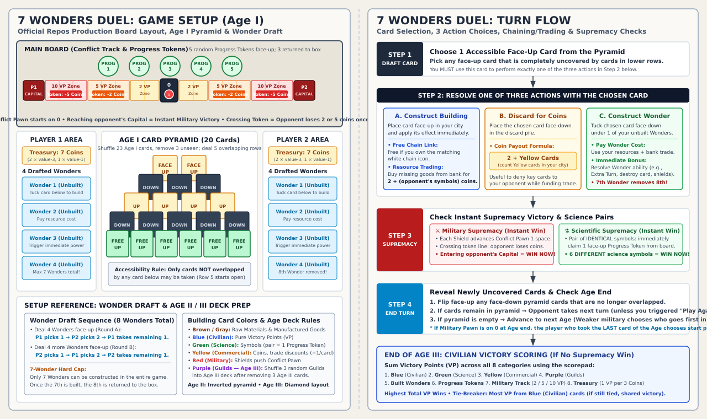

# 7 Wonders Duel — Quick Start Guide

**Players:** 2 | **Play Time:** ~30 min | **Complexity:** Light–Medium

---

## 1. Objective
Lead your civilization to victory across three Ages in one of three ways:
1. **Military Supremacy** *(Instant Win)*: Push the Conflict Pawn all the way into your opponent's capital.
2. **Scientific Supremacy** *(Instant Win)*: Collect **6 different** Scientific symbols.
3. **Civilian Victory** *(End of Age III)*: Have the most Victory Points (VP) if neither supremacy condition is triggered.

---

## 2. Setup
1. **Board & Tokens:** Place the board between both players. Put the **Conflict Pawn** on the center space (`0`), place the **4 Military Tokens** on their designated board slots, and randomly place **5 Progress Tokens** face-up in the top spaces (return the remaining 3 to the box).
2. **Starting Coins:** Give each player **7 coins** (`2 × value-3` and `1 × value-1`).
3. **Draft Wonders (8 Wonders Total):**
   * Deal 4 Wonder cards face-up; **Player 1** picks 1, **Player 2** picks 2, **Player 1** takes the last 1.
   * Deal 4 more Wonder cards face-up; **Player 2** picks 1, **Player 1** picks 2, **Player 2** takes the last 1.
4. **Age I Deck:** Shuffle the 23 Age I cards, remove **3 cards** blindly, and arrange the remaining 20 cards in the **Age I pyramid** (5 alternating face-up/face-down rows: `2–3–4–5–6`).

---

## 3. Turn Structure
Players alternate turns taking **1 accessible card** (a face-up card not overlapped by any card below it) and resolving **one of three actions**:

1. **Construct the Building (Card):**
   * Pay the resource/coin cost shown on the top-left of the card and place it in your city.
   * *Chain Rule:* If you already own a building with the matching white chain icon, build this card for **free**.
   * *Trading Rule:* Missing resources can be bought from the bank for `2 + (number of matching brown/gray resource symbols your opponent produces)` coins.
2. **Discard for Coins:**
   * Discard the card face-down to gain `2 + (number of Yellow Commercial cards in your city)` coins.
3. **Construct a Wonder:**
   * Tuck the chosen pyramid card face-down under one of your unbuilt Wonders, pay the Wonder's resource cost, and trigger its effect immediately.
   * **7-Wonder Hard Cap:** Only **7 Wonders total** can be built across both players—once the 7th Wonder is built, the 8th is removed from the game.

*After resolving your action, flip face-up any newly uncovered face-down cards in the pyramid.*

---

## 4. Key Mechanics & Milestones
* **Military (Red Cards & Shields):** Each shield moves the Conflict Pawn 1 space toward your opponent. Crossing a token line triggers the opponent's Military Token (they lose 2 or 5 coins once) and increases end-game VP (`2`, `5`, or `10` VP) for the advancing player.
* **Science (Green Cards):** Collecting a **pair of identical** science symbols lets you immediately claim 1 of the 5 face-up Progress Tokens on the board.
* **End of an Age:** When the pyramid is empty, set up the next Age's structure (**Age II**: inverted pyramid; **Age III**: diamond layout with **3 random Guild cards** shuffled into the deck after removing 3 Age III cards). The player with the weaker military (pawn closer to their capital) chooses who goes first in the next Age (if pawn is on `0`, the player who took the last card chooses).

---

## 5. End-Game Scoring (If No Supremacy Win)
Sum points across all 8 categories:
1. **Blue (Civilian) Cards**
2. **Green (Science) Cards**
3. **Yellow (Commercial) Cards**
4. **Purple (Guild) Cards**
5. **Built Wonders**
6. **Progress Tokens**
7. **Military Track** (`2`, `5`, or `10` VP depending on the pawn's zone)
8. **Treasury:** `1 VP` per **3 coins** (rounded down)

*Tie-breaker: Most VP from Blue (Civilian) cards (if still tied, shared victory).*
