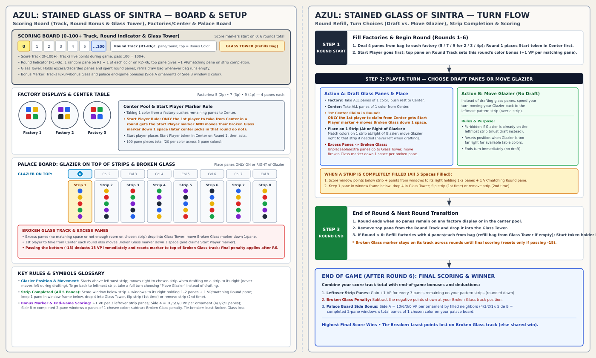

# Azul: Stained Glass of Sintra — Quick Start Guide

**Players:** 2–4 | **Play Time:** ~30–45 min | **Complexity:** Light–Medium

---

## 1. Objective
Craft stained glass windows across **6 rounds** by drafting translucent glass panes onto the **8 vertical strips** of your palace board, scoring points for completed strips, windows, and palace bonuses to finish with the **highest score** on the score track.

---

## 2. Setup
1. **Score Track & Bag:** Place the score track (`0–100+`) and put all **90 glass panes** (`15` in each of `6` colors) into the cloth bag. Each player places a scoring marker on `0`.
2. **Factory Displays:** Place **5** (2 players), **7** (3 players), or **9** (4 players) factory displays around the center of the table, and place the **Start Player marker** nearby.
3. **Palace Boards & Glaziers:** Give each player a palace board with **8 strips** (each holding up to `5` glass panes) and a **Glazier** marker positioned on the first strip.

---

## 3. Round & Turn Structure
Each of the **6 rounds** runs until all factories and the center pool are empty:

1. **Refill Factories:** Place **4 random glass panes** from the bag onto each factory display. Keep the center pool empty at the start of the round.
2. **Draft & Place Panes (Clockwise):** On your turn, choose **one** drafting source:
   * **From a Factory:** Pick **1 color** and take **all** glass panes of that color from that factory; push the remaining panes of that factory into the center pool.
   * **From the Center:** Pick **1 color** and take **all** glass panes of that color from the center pool. The **first player** to take from the center in a round also claims the **Start Player marker** (to act first next round).
   * Place drafted panes onto matching color spaces on a chosen strip of your palace board, and resolve any unplaced/excess panes per strip/floor rules.
3. **End-of-Round Scoring:** Score points for completed strips/windows on your palace board and advance along the score track. If fewer than 6 rounds have been played, begin the next round with the player holding the Start Player marker.

---

## 4. Key Mechanics & Edge Cases
* **All-of-One-Color Rule:** Whenever you draft from a factory or the center, you must take **every** pane of the chosen color from that single source.
* **Start Player Shift:** Taking from the center is strategic—even when panes are scarce, claiming the Start Player marker sets up first pick on the next round's fresh factories.
* **6-Round Hard Cap:** Unlike the original *Azul* (which ends immediately when a horizontal line is finished), *Stained Glass of Sintra* always plays **6 full rounds**.

---

## 5. End-Game Trigger & Scoring
* **End Trigger:** Completion of **Round 6**.
* **Scoring Categories:** Score track points accumulated across Rounds 1–6 plus end-game palace/window bonuses (minus any penalties).
* **Tie-Breaker:** Follow the official rulebook tie-breaker for tied final scores (or shared victory).