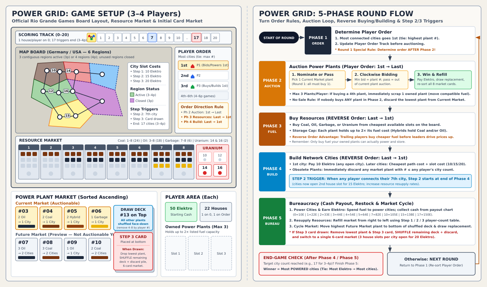

# Power Grid — Quick Start Guide

**Players:** 2–6 | **Play Time:** ~120 min | **Complexity:** Medium–Heavy

---

## 1. Objective
Supply electricity to the **most cities** in your network on the final round when a player triggers the end-game city count. Winning depends on **how many cities you can power**, not just how many houses you built on the map.

---

## 2. Setup
1. **Map & Regions:** Select the board side and number of contiguous regions matching the player count (e.g., 3 regions for 2–3 players, 4 for 4 players, 5 for 5–6 players).
2. **Starting Cash & Houses:** Each player takes **22 houses** in one color and **50 Elektro**, placing 1 house on space `0` of the Scoring Track and 1 house on the Player Order Track.
3. **Power Plant Market:** Arrange the initial **4-plant Current Market** (`#03–#06`) and **4-plant Future Market** (`#07–#10`) in ascending order. Place plant `#13` on top of the draw deck and the **Step 3** card at the bottom.
4. **Resource Market:** Stock starting resources along the bottom of the board (`Coal` on `1–8`, `Oil` on `3–8`, `Garbage` on `7–8`, and `Uranium` on `14` & `16`).

---

## 3. Round & Turn Structure
Each round follows **5 phases** (*in Round 1, determine player order after Phase 2*):

1. **Determine Player Order:** Most connected cities goes first (tie-breaker: highest-numbered power plant owned).
2. **Auction Power Plants (1st → Last):** In player order, nominate a plant from the **Current Market** to auction clockwise or pass for the round (in Round 1, every player must buy 1 plant). Max **3 plants** per player (scrap an old plant immediately if buying a 4th). If nobody buys any plant, discard the lowest plant.
3. **Buy Resources (Reverse Order: Last → 1st):** Purchase Coal, Oil, Garbage, or Uranium from the cheapest available slots and store up to **2×** a plant's fuel requirement.
4. **Building (Reverse Order: Last → 1st):** Connect new cities to your network by paying city slot cost (`10 / 15 / 20 Elektro`) + cheapest connection path cost. Immediately discard any market plant with number `≤` any player's city count.
5. **Bureaucracy:**
   * Spend fuel from your plants to power cities and collect **Elektro** from the payout chart (`0 = 10E`, `1 = 22E`, `2 = 33E`, `3 = 44E`, `4 = 54E`, `5 = 64E`, `7 = 82E`, `10 = 105E`, `15 = 138E`, `17 = 150E`).
   * Resupply resources from right to left according to the current Step & player-count chart.
   * Cycle the highest-numbered Future Market plant to the bottom of the deck and draw a replacement (in Steps 1–2).

---

## 4. Key Mechanics & Milestones (Steps 1, 2, 3)
* **Reverse Order Advantage:** Going last in **Buy Resources** and **Building** lets you buy cheaper fuel and avoid blocked city slots.
* **Step 2:** Triggered at the end of Phase 4 when any player connects their **7th city**—cities now allow up to **2 houses** (`15 Elektro` for the 2nd slot), and resource resupply rates increase.
* **Step 3:** Triggered when the **Step 3** card is drawn—remove the lowest plant and Step 3 card, shuffle the deck, merge into a **single 6-card market**, and open the **3rd city slot** (`20 Elektro`).
* **End Game Trigger:** Once a player reaches the target city count (`17` cities for 3–4 players; `21` for 2 players; `15` for 5; `14` for 6), finish Phase 5 of the current round.

---

## 5. End-Game Scoring & Tie-Breakers
1. **Winner:** Player who can **power the most cities** in their network on the final turn.
2. **Tie-Breaker 1:** Most remaining **Elektro**.
3. **Tie-Breaker 2:** Most **connected cities** on the map.
